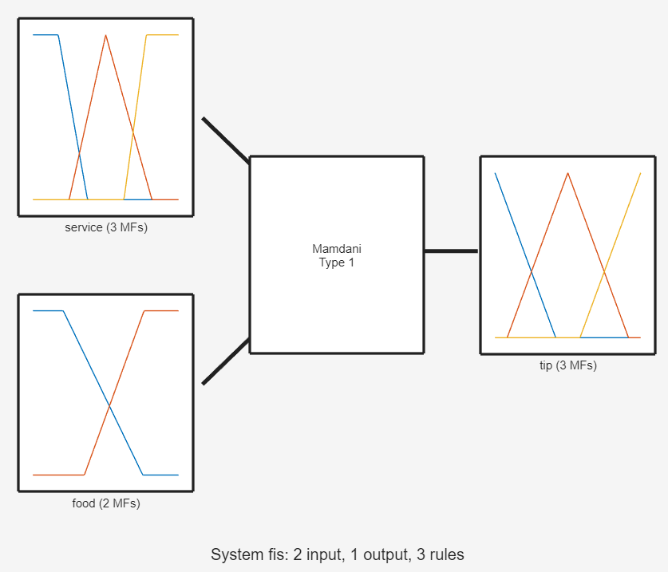
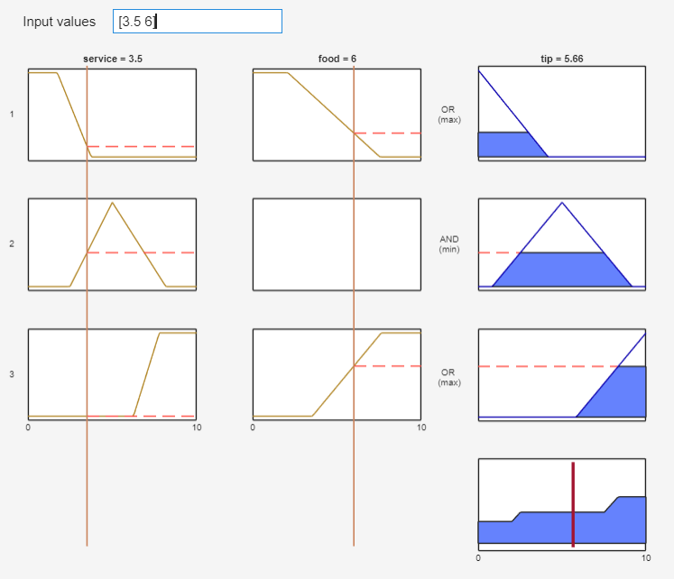
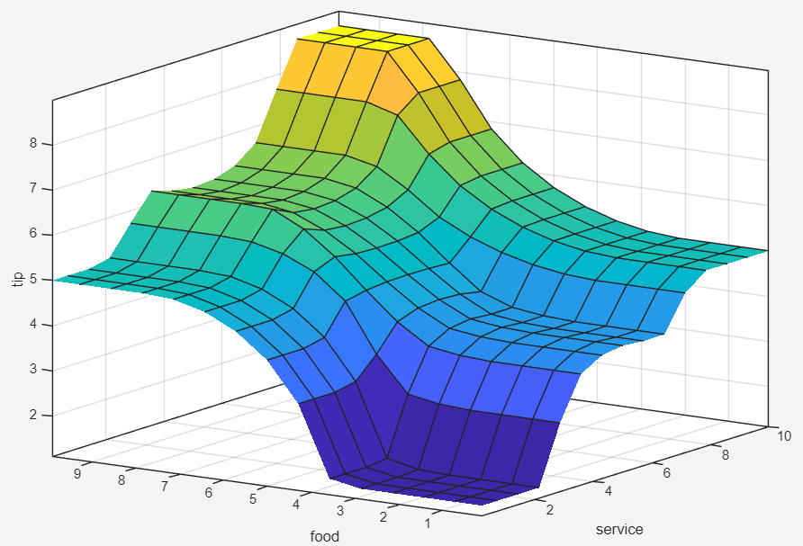
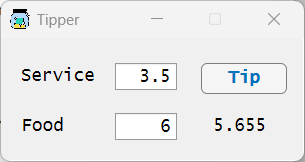

# Fuzzy Tipper in MATLAB

This project demonstrates the implementation of a **Mamdani Type-1 Fuzzy Inference System (FIS)** in **MATLAB R2024b**. The graphical user interface (GUI) was developed using **MATLAB App Designer**.

The application illustrates the well-known **restaurant tipping problem**, a classical example in fuzzy logic. The system determines an appropriate tip percentage based on two input variables:

- **Food Quality**
- **Service Quality**

Using a set of fuzzy rules, the FIS computes a single output variable:

- **Tip (%)**: the recommended tip expressed as a percentage of the total bill amount.

This project is intended for educational purposes and provides an interactive way to explore fuzzy sets, membership functions, rule bases, inference mechanisms, and defuzzification within a Mamdani fuzzy logic framework.

## Fuzzy Inference System

The fuzzy inference system, rule base, surface viewer, and graphical user interface are shown below.

### Fuzzy Inference System

### Rule Base

### Surface Viewer

### Graphical User Interface

> [!NOTE]
> **Icon attribution:** Tips icon created by   `SetitikPixelStudio` from [Flaticon](https://www.flaticon.com/free-icons/tips) and used under the Flaticon license.
